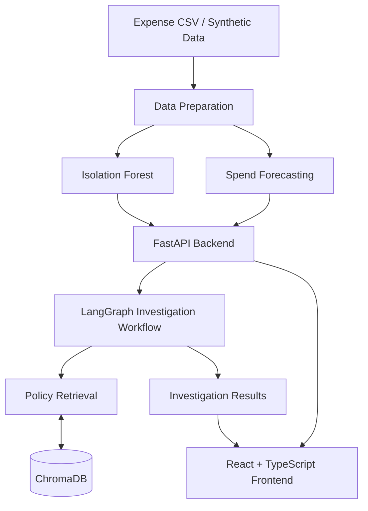

# FinanceHub

<h3 align="center">AI-Powered Financial Intelligence Platform</h3>

<p align="center">
  Detect anomalous expenses, forecast spending, and investigate transactions with policy-backed evidence.
</p>

<p align="center">
  
  
  
  
  
  
</p>

<p align="center">
  <a href="https://github.com/Ghost0734/FinanceHub">Source Code</a>
  ·
  <a href="https://gitdiagram.com/ghost0734/financehub">Architecture Diagram</a>
</p>

---

## Overview

FinanceHub is an end-to-end financial intelligence application that transforms expense transactions into actionable insights.

It combines machine learning, policy retrieval, and graph-based investigation workflows to identify unusual spending, forecast daily expenditure, and support transaction reviews with relevant policy evidence.

The platform integrates a React and TypeScript frontend with a FastAPI backend, machine learning services, ChromaDB policy retrieval, and LangGraph investigation orchestration.

## Features

<table>
  <tr>
    <td width="50%">
      <h3>Expense Anomaly Detection</h3>
      Identify potentially unusual transactions using the Isolation Forest algorithm.
    </td>
    <td width="50%">
      <h3>Spend Forecasting</h3>
      Forecast daily expenditure to understand spending patterns and expected costs.
    </td>
  </tr>
  <tr>
    <td width="50%">
      <h3>Policy Intelligence</h3>
      Retrieve relevant financial policy evidence using ChromaDB.
    </td>
    <td width="50%">
      <h3>AI-Assisted Investigations</h3>
      Orchestrate transaction investigations with LangGraph and supporting evidence.
    </td>
  </tr>
  <tr>
    <td width="50%">
      <h3>Interactive Dashboard</h3>
      Explore transaction insights, risk indicators, spending summaries, and forecasts.
    </td>
    <td width="50%">
      <h3>CSV Data Analysis</h3>
      Upload expense data for analysis within the running application session.
    </td>
  </tr>
</table>

## Architecture

<p align="center">
  <a href="https://gitdiagram.com/ghost0734/financehub">
    
  </a>
</p>

<p align="center">
  <em>Explore the interactive system architecture.</em>
</p>

### Processing Pipeline



## Tech Stack

| Layer | Technologies |
|---|---|
| Frontend | React, TypeScript, Vite |
| Backend | Python, FastAPI, Uvicorn |
| Machine Learning | Scikit-learn, Isolation Forest, Linear Regression |
| Investigation Orchestration | LangGraph |
| Policy Retrieval | ChromaDB, lexical fallback |
| Data Processing | Pandas |
| Testing | Pytest |
| Containerization | Docker, Docker Compose |
| Container Registry | GitHub Container Registry (GHCR) |
| Cloud Infrastructure | AWS EC2, AWS Systems Manager |
| CI/CD | GitHub Actions, AWS IAM OIDC |

## Getting Started

### Prerequisites

- Python compatible with the project's dependencies
- Node.js and npm
- Git
- Docker and Docker Compose (optional)

### 1. Clone the Repository

```bash
git clone https://github.com/Ghost0734/FinanceHub.git
cd FinanceHub
```

### 2. Set Up the Backend

Create and activate a virtual environment.

**Windows**

```powershell
python -m venv .venv
.venv\Scripts\Activate.ps1
```

**macOS / Linux**

```bash
python -m venv .venv
source .venv/bin/activate
```

Install dependencies and run the tests:

```bash
pip install -r requirements.txt
pytest -q
```

### 3. Start the FastAPI Backend

```bash
uvicorn main:app --reload
```

The API is available at `http://127.0.0.1:8000`.

Interactive API documentation is available at `http://127.0.0.1:8000/docs`.

### 4. Start the React Frontend

Open another terminal:

```bash
cd frontend
npm install
npm run dev
```

Open the local URL printed by Vite.

Configure the frontend API base URL to point to the running FastAPI backend using the configuration supported by the project.

> Check `frontend/package.json` for the available development and build scripts, and the source configuration for any required environment variables.

## Analyze Your Own Expense Data

FinanceHub supports CSV-based expense analysis through its documented local data-upload workflow.

1. Open the dashboard.
2. Navigate to **Overview → Analyze your own expense data**.
3. Upload your expense CSV.
4. Review the resulting analysis and potentially anomalous transactions.

### Supported CSV Fields

| Field | Description |
|---|---|
| `date` | Transaction date |
| `merchant` | Merchant or vendor name |
| `category` | Expense category |
| `amount` | Transaction amount |

Common alternative field names include `transaction_date`, `vendor`, `expense_category`, and `transaction_amount`.

**Data handling:** The documented local CSV workflow processes uploaded data within the running application session rather than sending the file to a separate cloud analytics service. This describes the local analysis flow, not a blanket guarantee about all deployment configurations.

## API Reference

FinanceHub exposes a REST API through FastAPI.

| Method | Endpoint | Description |
|---|---|---|
| `GET` | `/health` | Check service health |
| `GET` | `/transactions` | Retrieve scored transactions |
| `GET` | `/transactions?anomalies_only=true` | Retrieve flagged transactions |
| `GET` | `/forecast?days=7` | Retrieve a daily spending forecast |
| `GET` | `/summary` | Retrieve executive spending and risk metrics |
| `POST` | `/investigations` | Investigate a transaction |

### Example: Transaction Investigation

**Request**

```http
POST /investigations
Content-Type: application/json
```

**Body**

```json
{
  "transaction_id": "TXN-00001"
}
```

The investigation workflow is designed to assemble transaction findings, relevant policy evidence, verification details, and a summary.

For complete request schemas and response models, visit the interactive API documentation at `/docs`.

## Machine Learning and Investigation Workflow

### 1. Transaction Preparation

Synthetic or uploaded expense data is normalized into a consistent structure for downstream processing.

### 2. Anomaly Detection

Isolation Forest identifies transactions that differ from learned spending patterns. Flagged transactions are candidates for review, not proof of fraud.

### 3. Spend Forecasting

The forecasting service estimates daily spending using the configured forecasting model.

### 4. Policy Retrieval

ChromaDB retrieves relevant financial policy evidence to support transaction reviews. A lexical fallback helps maintain retrieval functionality in supported environments where the native ChromaDB dependency cannot load.

### 5. Investigation Orchestration

LangGraph coordinates the investigation workflow, connecting transaction findings with retrieved policy evidence and investigation results.

## Docker

FinanceHub includes Docker and Docker Compose configurations for containerized execution.

Build and start the local services:

```bash
docker compose up --build
```

The repository also includes a production Compose configuration in `compose.prod.yaml`.

Review the Compose files and Dockerfile for the configured services, ports, environment variables, and deployment requirements.

## Deployment and CI/CD

FinanceHub uses GitHub Actions to automate container builds and deployment to AWS EC2.

### Deployment Pipeline

1. **Build the Docker image:** GitHub Actions builds the application container using the repository's Docker configuration.
2. **Push to GHCR:** The built image is published to GitHub Container Registry (GHCR) for storage and retrieval during deployment.
3. **Authenticate to AWS with OIDC:** GitHub Actions assumes an AWS IAM role through OpenID Connect federation, avoiding long-lived AWS access keys in GitHub Actions secrets.
4. **Deploy to EC2 through Systems Manager:** AWS Systems Manager executes deployment commands on the EC2 instance, enabling remote application updates without relying on SSH-based deployment.

### Infrastructure Highlights

- Containerized application deployment with Docker.
- Automated CI/CD through GitHub Actions.
- Federated AWS authentication using IAM and OIDC.
- Container image distribution through GHCR.
- Remote deployment orchestration through AWS Systems Manager.

## Testing

Run the backend test suite:

```bash
pytest -q
```

Run frontend checks using the scripts defined in `frontend/package.json`. For example, if supported:

```bash
cd frontend
npm run lint
npm run build
```

## Design Principles

- **Modularity:** Separate API handling, data preparation, machine learning, policy retrieval, and investigation orchestration.
- **Explainability:** Present relevant policy evidence alongside investigation findings wherever supported.
- **Reproducibility:** Use deterministic data generation and repeatable analysis workflows where configured.
- **Reliability:** Validate input data and test critical application behavior.
- **Privacy-conscious analysis:** Support local expense analysis without requiring every dataset to be sent to an external analytics service.

## Limitations

FinanceHub is an MVP for financial analytics and investigation workflows. Anomaly scores are indicators rather than proof of fraud, forecasts are estimates, and retrieved policy evidence should be reviewed in context before financial or compliance decisions are made.

## Author

**Abhishek Sharma**

[GitHub Profile](https://github.com/Ghost0734)

---

<p align="center">
  <strong>FinanceHub</strong><br/>
  Turning financial data into actionable intelligence.
</p>
