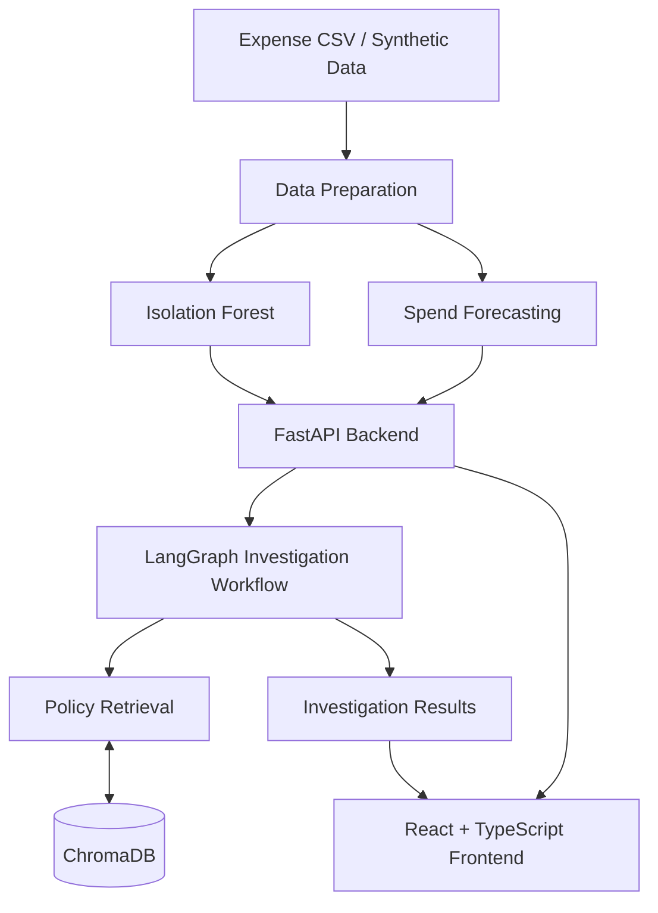

# FinanceHub

<h3 align="center">AI-Powered Financial Intelligence Platform</h3>

<p align="center">
  Detect anomalous expenses, forecast spending, and investigate transactions with policy-backed evidence.
</p>

<p align="center">
  <a href="http://13.206.92.204/">
    
  </a>
  <a href="https://github.com/Ghost0734/FinanceHub">
    
  </a>
</p>

<p align="center">
  
  
  
  
  
  
</p>

---

## Live Demo

**FinanceHub is deployed on AWS EC2 and available to test online.**

Explore the application directly through the live deployment:

### [🚀 Launch FinanceHub](http://13.206.92.204/)

Test the available financial analytics workflows, explore spending insights, review potentially anomalous transactions, and examine forecasts and investigation results.

No local installation is required to try the deployed application.

> **Privacy notice:** The live demo uses HTTP rather than HTTPS. Please use sample or synthetic data and avoid uploading confidential financial records, personal information, or sensitive business data.

## Overview

FinanceHub is an end-to-end financial intelligence platform that transforms expense transactions into actionable insights.

It combines machine learning, policy retrieval, and graph-based investigation workflows to identify unusual spending, forecast daily expenditure, and support transaction reviews with relevant policy evidence.

The application integrates a React and TypeScript frontend, a FastAPI backend, machine learning services, ChromaDB policy retrieval, and LangGraph investigation orchestration.

## Features

| Feature | Description |
|---|---|
| Expense Anomaly Detection | Identify potentially unusual transactions using Isolation Forest. |
| Spend Forecasting | Forecast daily expenditure to analyze spending patterns and expected costs. |
| Policy Intelligence | Retrieve relevant financial policy evidence using ChromaDB. |
| AI-Assisted Investigations | Orchestrate transaction investigations using LangGraph and supporting evidence. |
| Interactive Dashboard | Explore spending summaries, risk indicators, forecasts, and transaction insights. |
| CSV Analysis | Upload expense data through the supported analysis workflow. |
| REST API | Access transaction analysis, forecasts, summaries, and investigations through FastAPI. |

## Architecture

<p align="center">
  <a href="https://gitdiagram.com/ghost0734/financehub">
    
  </a>
</p>

<p align="center">
  <em>Explore the interactive system architecture.</em>
</p>

### Data and Investigation Pipeline



## Technology Stack

| Layer | Technologies |
|---|---|
| Frontend | React, TypeScript, Vite |
| Backend | Python, FastAPI, Uvicorn |
| Machine Learning | Scikit-learn, Isolation Forest, Linear Regression |
| Investigation Orchestration | LangGraph |
| Policy Retrieval | ChromaDB, lexical fallback |
| Data Processing | Pandas |
| Testing | Pytest |
| Containerization | Docker, Docker Compose |
| Container Registry | GitHub Container Registry (GHCR) |
| Cloud Infrastructure | AWS EC2, AWS Systems Manager |
| CI/CD | GitHub Actions, AWS IAM OIDC |

## How It Works

### 1. Transaction Processing

Synthetic or uploaded expense data is normalized into a consistent structure for downstream analysis.

### 2. Anomaly Detection

Isolation Forest identifies transactions that differ from learned spending patterns. Flagged transactions are candidates for review, not proof of fraud.

### 3. Spend Forecasting

The forecasting service estimates daily spending using the configured forecasting model.

### 4. Policy Retrieval

ChromaDB retrieves relevant financial policy evidence to support transaction reviews. A lexical fallback supports retrieval in compatible environments where the native ChromaDB dependency cannot load.

### 5. Investigation Orchestration

LangGraph coordinates the investigation workflow, connecting transaction findings with retrieved policy evidence and investigation results.

## API Reference

FinanceHub exposes a REST API through FastAPI.

| Method | Endpoint | Description |
|---|---|---|
| `GET` | `/health` | Check service health |
| `GET` | `/transactions` | Retrieve scored transactions |
| `GET` | `/transactions?anomalies_only=true` | Retrieve flagged transactions |
| `GET` | `/forecast?days=7` | Retrieve a daily spending forecast |
| `GET` | `/summary` | Retrieve spending and risk metrics |
| `POST` | `/investigations` | Investigate a transaction |

### Example Investigation Request

```http
POST /investigations
Content-Type: application/json
```

```json
{
  "transaction_id": "TXN-00001"
}
```

The investigation workflow is designed to assemble transaction findings, relevant policy evidence, verification details, and an investigation summary.

For complete request schemas and response formats, consult the FastAPI interactive documentation at `/docs` when the backend endpoint is accessible.

## Deployment and CI/CD

FinanceHub is deployed on AWS EC2 using a containerized deployment pipeline automated through GitHub Actions.

### Deployment Pipeline

1. **Build the Docker image:** GitHub Actions builds the application container using the repository's Docker configuration.
2. **Push to GHCR:** The built image is published to GitHub Container Registry (GHCR) for storage and retrieval during deployment.
3. **Authenticate to AWS with OIDC:** GitHub Actions assumes an AWS IAM role through OpenID Connect federation, avoiding long-lived AWS access keys in GitHub Actions secrets.
4. **Deploy to EC2 through Systems Manager:** AWS Systems Manager executes deployment commands on the EC2 instance, enabling remote application updates without relying on SSH-based deployment.

### Infrastructure Highlights

- Containerized deployment with Docker.
- Automated CI/CD using GitHub Actions.
- Federated AWS authentication through IAM and OIDC.
- Container image distribution through GHCR.
- Remote deployment orchestration using AWS Systems Manager.

## Run Locally

Want to explore or modify the source code?

### Prerequisites

- Python compatible with the project dependencies
- Node.js and npm
- Git
- Docker and Docker Compose (optional)

### Backend Setup

Clone the repository:

```bash
git clone https://github.com/Ghost0734/FinanceHub.git
cd FinanceHub
```

Create and activate a virtual environment.

**Windows**

```powershell
python -m venv .venv
.venv\Scripts\Activate.ps1
```

**macOS / Linux**

```bash
python -m venv .venv
source .venv/bin/activate
```

Install dependencies and run the tests:

```bash
pip install -r requirements.txt
pytest -q
```

Start the FastAPI backend:

```bash
uvicorn main:app --reload
```

API documentation: `http://127.0.0.1:8000/docs`

### Frontend Setup

In a separate terminal:

```bash
cd frontend
npm install
npm run dev
```

Open the local URL printed by Vite. Configure the frontend API base URL according to the project's configuration.

### Docker

Build and start the configured local services:

```bash
docker compose up --build
```

Review `compose.yaml` for service definitions, ports, and required environment variables.

> These commands reflect the documented entry points. Check the repository's current configuration for the supported Python version, frontend scripts, and environment variables.

## Testing

Run the backend test suite:

```bash
pytest -q
```

Run frontend linting and a production build using the scripts available in `frontend/package.json`.

## Design Principles

- **Modularity:** Separate API handling, data preparation, machine learning, policy retrieval, and investigation orchestration.
- **Explainability:** Support investigation findings with relevant policy evidence wherever available.
- **Reproducibility:** Use deterministic data generation and repeatable analysis workflows where configured.
- **Reliability:** Validate input data and test critical application behavior.
- **Privacy-conscious analysis:** Support local expense analysis without requiring every dataset to be sent to an external analytics service.

## Limitations

FinanceHub is an MVP for financial analytics and investigation workflows. Anomaly scores are indicators rather than proof of fraud, forecasts are estimates, and retrieved policy evidence should be reviewed in context before financial or compliance decisions are made.

## Author

**Abhishek Sharma**

[GitHub Profile](https://github.com/Ghost0734)

---

<p align="center">
  <strong>FinanceHub</strong><br/>
  Turning financial data into actionable intelligence.
</p>
